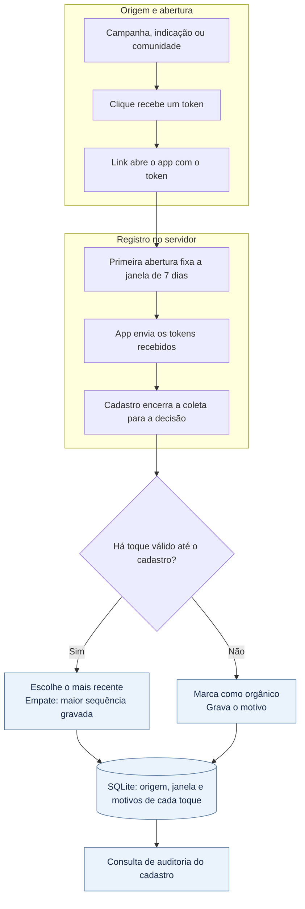

# Origem do cadastro no app

[](https://github.com/leonardoperin14/conty-challenge-06-origem/actions/workflows/ci.yml)

API que identifica de onde veio um cadastro: campanha, indicação, comunidade ou acesso orgânico. Cada clique recebe um token que o app envia ao servidor. No cadastro, a API escolhe a origem e grava por que cada toque venceu ou foi descartado.

Um **toque** é o registro desse token em uma instalação do app. A origem viaja no token, sem depender do cabeçalho `Referer`.

**TypeScript · Node.js 24.12+ · Hono · SQLite · node:test**

## Execução

```bash
npm ci
npm start
```

A API inicia em `http://localhost:3000`. Para validar:

```bash
npm test
npm run typecheck
```

| Variável | Padrão | Descrição |
| --- | --- | --- |
| `PORT` | `3000` | Porta HTTP |
| `PUBLIC_BASE_URL` | `http://localhost:${PORT}` | URL pública usada nos links |
| `DATABASE_PATH` | `./data/attribution.sqlite` | Caminho do banco |

## Fluxo



1. Crie um link e emita um token por clique.
2. Na primeira abertura do app, registre `installation_id` e guarde a resposta com a janela de validade.
3. Envie cada token recebido para `/app/touches`. Antes do cadastro, envie os tokens pendentes.
4. Registre o cadastro com um `signup_id` estável e consulte sua atribuição.

| Método | Rota | Descrição |
| --- | --- | --- |
| `GET` | `/health` | Estado da API |
| `POST` | `/links` | Cria um link de origem |
| `POST` | `/clicks` | Emite ou recupera o token de um clique |
| `GET` | `/open?touch=TOKEN` | Redireciona para `conty://open?touch=TOKEN` |
| `POST` | `/app/first-open` | Registra a primeira abertura e fixa a janela |
| `POST` | `/app/touches` | Associa um token à instalação |
| `POST` | `/signups` | Registra o cadastro e persiste a decisão |
| `GET` | `/signups/:signup_id/attribution` | Retorna a decisão e a auditoria |

A regra de atribuição está em [`src/attribution.ts`](src/attribution.ts), separada das rotas em [`src/app.ts`](src/app.ts) e da persistência em [`src/store.ts`](src/store.ts).

## Links e cadastro

Crie um link de campanha ou indicação. `community` também é aceito como origem.

```bash
curl -X POST http://localhost:3000/links \
  -H 'Content-Type: application/json' \
  -d '{"source":"campaign","reference_id":"tiktok-outubro-2026"}'

curl -X POST http://localhost:3000/links \
  -H 'Content-Type: application/json' \
  -d '{"source":"referral","reference_id":"creator-42"}'
```

Cada resposta traz `link_id`, `source`, `reference_id` e `click_endpoint`. Use o `link_id` retornado para registrar um clique:

```bash
curl -X POST http://localhost:3000/clicks \
  -H 'Content-Type: application/json' \
  -d '{"link_id":"LINK_ID","click_id":"click-001"}'
```

A resposta inclui um `touch_token` e os endereços de abertura. Exemplos ilustrativos, com tokens emitidos para cada origem:

```text
Campanha:  http://localhost:3000/open?touch=TOKEN_CAMPANHA
Indicação: http://localhost:3000/open?touch=TOKEN_INDICACAO
Deep link: conty://open?touch=TOKEN
```

Abrir a URL apenas redireciona; o toque é registrado quando o app envia o token:

```bash
curl -X POST http://localhost:3000/app/first-open \
  -H 'Content-Type: application/json' \
  -d '{"installation_id":"install-001"}'

curl -X POST http://localhost:3000/app/touches \
  -H 'Content-Type: application/json' \
  -d '{"installation_id":"install-001","touch_token":"TOKEN"}'

curl -X POST http://localhost:3000/signups \
  -H 'Content-Type: application/json' \
  -d '{"installation_id":"install-001","signup_id":"signup-001"}'
```

## Regra de atribuição

**Vence o último toque válido antes ou no instante do cadastro.** Campanha, indicação e comunidade têm o mesmo peso: o que decide é o horário do registro, pela política `LAST_VALID_TOUCH`.

Por exemplo, se uma campanha foi registrada às 10h e uma indicação às 11h, antes de um cadastro às 12h, a indicação vence. Se os dois toques tiverem o mesmo horário, vence o que foi gravado depois, identificado pela maior `sequence`. Isso torna o desempate previsível, inclusive quando horários escritos com fusos diferentes representam o mesmo instante.

A validade é de **168 horas (7 dias) desde a primeira abertura registrada pelo servidor**, com início e fim inclusivos. Se a primeira abertura foi em 09/10 às 12h, a janela termina em 16/10 às 12h. O toque e o cadastro precisam estar dentro desse intervalo. Novos cliques e reenvios da primeira abertura não renovam a janela.

| Situação | Resultado |
| --- | --- |
| Mais de um toque válido | Vence o de maior `recorded_at` |
| Mesmo instante, inclusive com offsets diferentes | Vence a maior sequência persistida |
| Toque fora da janela | Não vence; motivo `OUTSIDE_WINDOW` |
| Toque com horário posterior ao cadastro | Não vence; motivo `AFTER_SIGNUP` |
| Cadastro após o fim da janela | Origem `organic`, motivo `SIGNUP_AFTER_WINDOW` |
| Nenhum toque válido | Origem `organic`, motivo `NO_VALID_TOUCH` |

O horário considerado é o recebimento de `/app/touches` pelo servidor. Um clique emitido antes, mas enviado pelo app depois do cadastro, não muda a origem: aparece em `later_touches` com motivo `AFTER_SIGNUP`.

**Sem origem válida, o cadastro é explicitamente orgânico.** A API grava `attribution_type: "organic"`, `selected_touch_token: null` e o motivo: `NO_VALID_TOUCH` quando nenhum toque é válido, ou `SIGNUP_AFTER_WINDOW` quando o cadastro ocorreu após o prazo. A ausência de origem fica explicada e pode ser consultada depois.

## Idempotência

**O mesmo clique não cria duas origens.** Repetir `click_id` no mesmo link devolve o mesmo token; usá-lo em outro link retorna `409`. Reenviar o token à mesma instalação preserva o toque e seu horário original, sem criar outro evento nem fazê-lo parecer mais recente.

Repetir o cadastro com o mesmo `signup_id` e instalação retorna a decisão já gravada. Identidades conflitantes retornam `409`. As gravações usam transações e restrições de unicidade no SQLite.

## Auditoria

A resposta de `POST /signups` já inclui a decisão e os toques considerados. Para consultá-la depois, use:

```bash
curl http://localhost:3000/signups/signup-001/attribution
```

A consulta acrescenta `later_touches`, com os toques recebidos após o cadastro. Em cada toque, `eligible` informa se ele podia concorrer, `selected` mostra se venceu e `reasons` explica o resultado. Exemplo de campanha seguida de indicação:

```json
{
  "signup_id": "signup-001",
  "installation_id": "install-001",
  "signup_at": "2026-10-10T12:00:00.000Z",
  "signup_sequence": 4,
  "window": {
    "started_at": "2026-10-09T12:00:00.000Z",
    "ends_at": "2026-10-16T12:00:00.000Z",
    "duration_hours": 168
  },
  "policy": {
    "name": "LAST_VALID_TOUCH",
    "window_hours": 168,
    "window_start": "FIRST_OPEN",
    "tie_break": "LATEST_PERSISTED_SEQUENCE"
  },
  "attribution_type": "referral",
  "selected_touch_token": "TOKEN_INDICACAO",
  "reason": "LAST_VALID_TOUCH",
  "touches": [
    {
      "touch_token": "TOKEN_CAMPANHA",
      "source": "campaign",
      "reference_id": "tiktok-outubro-2026",
      "recorded_at": "2026-10-09T13:00:00.000Z",
      "sequence": 2,
      "eligible": true,
      "selected": false,
      "reasons": ["SUPERSEDED_BY_LATER_TOUCH"]
    },
    {
      "touch_token": "TOKEN_INDICACAO",
      "source": "referral",
      "reference_id": "creator-42",
      "recorded_at": "2026-10-10T11:00:00.000Z",
      "sequence": 3,
      "eligible": true,
      "selected": true,
      "reasons": ["LAST_VALID_TOUCH"]
    }
  ],
  "later_touches": []
}
```

A campanha era válida, mas perdeu para uma indicação mais recente. Em empate de horário, o vencedor recebe `LATEST_SEQUENCE_ON_TIMESTAMP_TIE` e o outro recebe `TIE_LOST_TO_LATER_SEQUENCE`. A origem orgânica também fica persistida com motivo explícito.

## Testes

| Comportamento | Cobertura |
| --- | --- |
| Dois links: campanha seguida de indicação | A indicação vence e a campanha registra por que perdeu |
| Dois toques no mesmo horário | A maior sequência vence; ambos recebem motivos de desempate |
| Mesmo instante com fusos diferentes | O empate é reconhecido pelo instante |
| Clique ou token repetido | Mantém o token e um único toque por instalação |
| Janela de 7 dias | Aceita o limite exato e rejeita um milissegundo depois |
| Toque após o cadastro | Não vence e aparece na auditoria |
| Cadastro sem toque válido | Grava origem orgânica com motivo explícito |
| Reabertura do SQLite | Preserva a decisão e sua auditoria |

Os testes da regra estão em [`test/attribution.test.ts`](test/attribution.test.ts); os do fluxo HTTP, incluindo os casos de dois links e empate, estão em [`test/api.test.ts`](test/api.test.ts). Também há cobertura de JSON inválido ou vazio, rejeitado com `400` antes de qualquer gravação.

A validação registrada anteriormente usou Node.js 24.18.0: 13 testes passaram e `npm run typecheck` passou. Nesta atualização documental, esses comandos não foram executados novamente.

## Limitações

A API não autentica usuários. O fluxo depende de conexão para registrar abertura e toques; não reconstrói horários offline. Integração real com o app e deferred deep linking após instalação ficam fora desta implementação.

## Uso de IA e revisão

Usei o Codex para implementar a API, criar os testes e escrever a documentação. Também usei uma segunda sessão para revisão técnica. Com esse apoio, corrigi a auditoria de empates entre horários equivalentes e o tratamento de JSON inválido, com testes de regressão.

Minha revisão se concentrou nos critérios, nas decisões da solução e nas evidências de validação. Acompanhei o desenvolvimento e aprovei as correções. Não revisei cada linha do código; a revisão técnica e a execução dos testes foram feitas com o apoio da IA.
